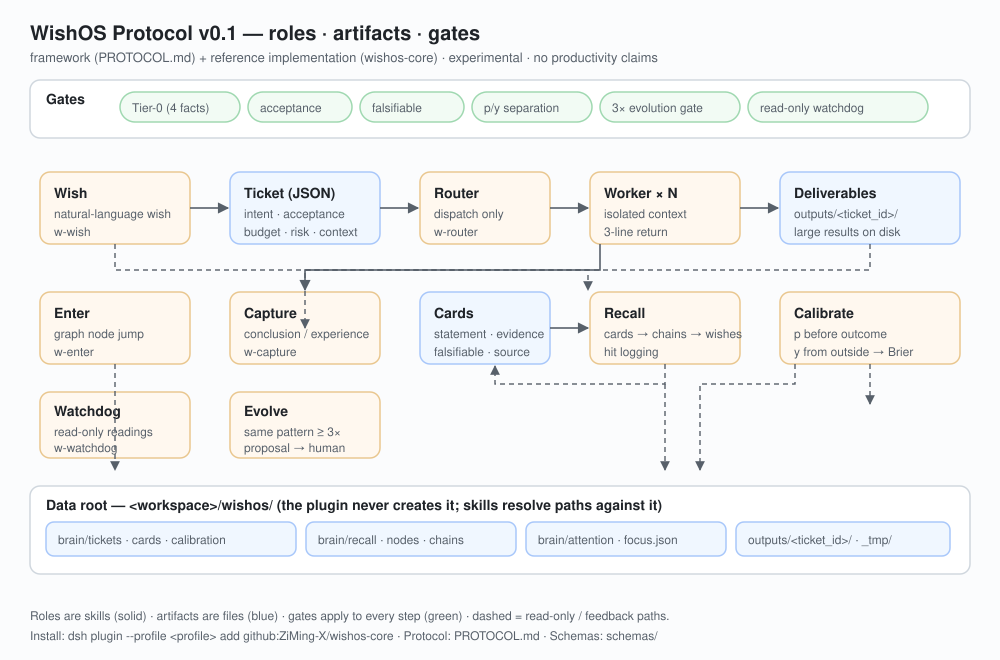

# wishos-core

> **WishOS Core** — a **wish-driven second-brain working-method framework** for
> [DeepSeek Harness](https://github.com/deepseek-ai/deepseek-harness) (`dsh`), shipped as a reference implementation:
> one agent preset + 8 `w-*` skills + a protocol + JSON Schemas + read-only self-check tools.

[](https://github.com/ZiMing-X/wishos-core/releases)
[](LICENSE)
[](PROTOCOL.md)

<p align="center"></p>



> 🟡 **Status: experimental (influence stage)**. This is a **framework / reference implementation**, not a turnkey product.
> No productivity-gain claims. [中文](README.md) · Install: `dsh plugin --profile <profile> add github:ZiMing-X/wishos-core`

## Version & compatibility

| Item | Value | Status |
|:--|:--|:--|
| Package | **wishos-core 0.3.2** | ✅ published ([repo](https://github.com/ZiMing-X/wishos-core) · [release](https://github.com/ZiMing-X/wishos-core/releases)) |
| Protocol | **WishOS Protocol v0.1** ([PROTOCOL.md](PROTOCOL.md)) | normative |
| Host | `engines.dsh`: `>=0.2.1-rc.2 <0.2.2-0 \|\| >=0.2.2-rc.1 <0.3.0-0` | ✅ tested on **dsh 0.2.1-rc.2** (Windows); others untested |
| Node.js | `>=22.19.0` | host requirement |
| Python (optional) | **≥3.14** (or `pip install zstandard`) | only for `tools/_wishos_cost_report.py`; without it the skill reports "not wired" |
| OS | Windows / macOS / Linux | preset loads `tool-pwsh` on Windows, `tool-bash` elsewhere |
| Not for | dsh < 0.2.1-rc.2 · UI/auto-executor needs · one-shot users | — |

## What it provides / what you fill in

| ✅ Provided | ❌ Not provided |
|:--|:--|
| Role contracts (Wish/Router/Worker/Capture/Recall/Calibrate/Watchdog/Evolve/Enter) and their boundaries | Domain capabilities (it does not make the model smarter) |
| Artifact schemas: Ticket / card / calibration / recall / node — machine-checkable (`schemas/`) | The data: your wishes, projects, card base, graph, calibration outcomes (`y`) |
| Gates: Tier-0 four facts · acceptance · falsifiability · p/y separation · 3x evolution gate · read-only watchdog | Automation: **no resident scheduler/auto-executor** (you create schedule tasks) |
| Data layout: a single data root `<workspace>/wishos/` + isolated preset | Indexing (FTS/vector), external integrations, backup/migration |
| Read-only self-check, schema validation and cost reporting tools | English skill bodies (the 8 skills are Chinese), multi-user collaboration |

**Who it is for**: people already using dsh who want an auditable wish → acceptance → card → calibration loop, or want to adopt only part of it (start with L1).
**Who it is not for**: people expecting "install and get faster"; GUI/auto-executor users.

## Adoption profiles

| Profile | Contents |
|:--|:--|
| **L1 minimal loop** | `w-wish` + `w-router` + `w-capture` + `w-recall` |
| **L2 standard** | L1 + `w-calibrate` + `w-watchdog` |
| **L3 full (default in this package)** | L2 + `w-evolve` + `w-enter` + graph/chain/focus stack |

## What installing does

1. registers an agent preset (id `wishos`): persona + **four Tier-0 hard facts** + tool surface + isolation three
   (no `agent-instructions` row, `includeDefaultRoots:false`, no touching other presets);
2. points the preset's skill root **inside this package** via the official `createRequire(baseUrl)` idiom;
3. registers the read-only tool `wishos_core_health` (preset registered / skill root resolved / 8 files present).

## Install

```sh
dsh plugin --profile <profile> add github:ZiMing-X/wishos-core
```

Then switch the session's agent preset to **WishOS**. Uninstall by removing the bundle.
⚠️ preset id is fixed to `wishos`; remove/rename an existing same-id preset first.

## Data root (one convention; the plugin never creates it)

```text
<workspace>/wishos/
├── brain/{cards,tickets,nodes,chains,recall,calibration,attention}/
├── outputs/
└── _tmp/
```

Relative paths in skills (`brain/cards/...`) resolve **against this data root**, not the session cwd.

## Self-check / tools (read-only)

```sh
python tools/_wishos_selfcheck.py --root <workspace>/wishos
python tools/_wishos_validate.py  --root <workspace>/wishos
python tools/_wishos_cost_report.py --days 7     # optional, Python ≥3.14
```

env: `DSH_HOME` (default `~/.dsh`) · `DSH_PROFILE` (default `web`) · `WISHOS_ROOT` (default `$PWD/wishos`).
`tools/dev/` contains author-environment checkers; they produce false reds on incomplete environments — do not use them as public self-check.

## Boundaries

- read-only host state; registers only the preset row, skill root and the health tool;
- isolation by design (`includeDefaultRoots:false`) — use a same-id `customSkillDirs` override to keep your own skills;
- no data collection / no network requests; sensitive data never leaves the machine (persona constraint).

## License

Apache-2.0 — see [LICENSE](LICENSE). Independent project by `ZiMing-X`; not affiliated with DeepSeek.
